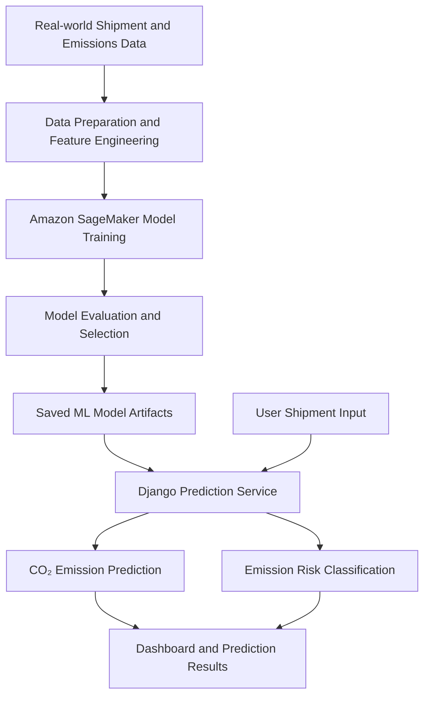

# CO₂ Emission Prediction for Shipments

A machine learning-powered web application that predicts shipment-related CO₂ emissions and classifies environmental risk based on logistics and transportation characteristics.

The project combines real-world shipment and emissions data, machine learning model development using **Amazon SageMaker**, and a Django web application to make emissions predictions accessible through a user-friendly dashboard.

## Overview

Transportation contributes significantly to supply-chain carbon emissions. Estimating the environmental impact of individual shipments can help organisations understand their logistics footprint and make more informed transportation decisions.

This project develops a machine learning solution to:

- Predict CO₂ emissions based on shipment characteristics.
- Classify shipments into Low, Medium, and High emission-risk categories.
- Compare multiple regression and classification algorithms.
- Present predictions and model evaluation results through an interactive Django dashboard.
- Deploy the application using Docker and a GitHub Actions-based deployment workflow.

The models were trained using externally collected real-world shipment and emissions data in Amazon SageMaker.

## Key Features

### Shipment management
- User registration and authentication.
- Create and manage shipment records.
- Capture shipment details such as transport mode, weight, distance, supplier, origin, destination, and product category.
- Record shipment-specific characteristics, including temperature control, export status, and hazardous-material status.

### CO₂ emission prediction
- Estimate shipment CO₂ emissions using a trained machine learning regression model.
- Calculate shipment transportation intensity using tonne-kilometres.
- Classify emission risk into Low, Medium, and High categories.
- Display prediction results within the application.

### Model evaluation and visualisation
- Compare regression and classification algorithms.
- Display model performance metrics.
- Visualise actual versus predicted emissions.
- Analyse residuals, feature importance, learning curves, and classification confusion matrices.

### Application deployment
- Django web application.
- Docker containerisation.
- Docker Compose configuration.
- GitHub Actions workflow for EC2 deployment.

## Machine Learning Workflow

The machine learning workflow uses real-world shipment and emissions data collected from an external source.

### 1. Data collection and preparation

Shipment-related information was collected and prepared for machine learning.

The features used by the saved model artifacts include:

| Feature | Description |
|---|---|
| Origin state | Shipment origin |
| Destination state | Shipment destination |
| Sector | Shipment industry sector |
| SCTG | Standard Classification of Transported Goods |
| Transport mode | Road, sea, rail, or air |
| Shipment value | Declared shipment value |
| Weight | Shipment weight in tonnes |
| Distance | Transportation distance in kilometres |
| Tonne-km | Weight × distance |
| Temperature controlled | Whether temperature-controlled transport is required |
| Export status | Whether the shipment is an export |
| Hazardous materials | Whether hazardous materials are involved |

### 2. Model training

Amazon SageMaker was used to train and evaluate the machine learning models.

Two machine learning tasks were developed:

**Regression – CO₂ emission prediction**

The regression task estimates the CO₂ emissions associated with a shipment.

Algorithms evaluated:
- Linear Regression
- Random Forest Regressor
- Gradient Boosting Regressor

**Classification – Emission risk prediction**

The classification task categorises shipment emissions into risk levels.

Algorithms evaluated:
- Logistic Regression
- Random Forest Classifier
- Decision Tree Classifier

### 3. Model selection

Models were compared using regression and classification evaluation metrics.

The selected models are:
- **Gradient Boosting Regressor** for CO₂ emission prediction.
- **Decision Tree Classifier** for emission-risk classification.

### 4. Model integration

The trained models are saved as Joblib artifacts and loaded by the Django application through the prediction service.

When a user submits shipment details, the application prepares the input features, generates predictions, and displays the estimated emissions and risk category.

If the trained model artifacts are unavailable, the application includes a baseline formula as a fallback.

## Model Performance

The following are the evaluation results recorded in the project's model comparison artifacts.

### Regression performance

| Algorithm | MAE | RMSE | R² |
|---|---:|---:|---:|
| Linear Regression | 52.30 | 527.46 | 0.1614 |
| Random Forest Regressor | 9.01 | 154.18 | 0.9284 |
| **Gradient Boosting Regressor** | **13.44** | **142.07** | **0.9392** |

The Gradient Boosting Regressor achieved the lowest RMSE and the highest R² among the evaluated regression models.

### Classification performance

| Algorithm | Accuracy | Precision | Recall | F1-score |
|---|---:|---:|---:|---:|
| Logistic Regression | 98.47% | 98.41% | 98.47% | 98.38% |
| Random Forest Classifier | 99.73% | 99.73% | 99.73% | 99.73% |
| **Decision Tree Classifier** | **99.97%** | **99.97%** | **99.97%** | **99.97%** |

The Decision Tree Classifier achieved the highest reported F1-score among the evaluated classification models.

*Note: These are the metrics recorded in the project's saved evaluation artifacts. They represent the reported test results and should be interpreted in the context of the dataset and target-label generation process.*

## Application Architecture

The project connects the trained machine learning models to a Django-based application.



### Application flow

1. A user logs into the Django application.
2. The user enters shipment information.
3. The application validates and processes the shipment data.
4. The prediction service loads the trained machine learning models.
5. The regression model estimates CO₂ emissions.
6. The classification model determines the emission-risk category.
7. The results are stored and displayed on the dashboard.

## Dashboard and Model Visualisations

The application includes visualisations to support model evaluation and analysis.

The generated visualisation files include:

- Regression model comparison – RMSE.
- Classification model comparison – F1-score.
- Learning curves for the selected regression and classification models.
- Actual versus predicted CO₂ emissions.
- Regression residual analysis.
- Classification confusion matrix.
- Regression feature importance.
- Classification feature importance.

## Technology Stack

| Category | Technologies |
|---|---|
| Programming | Python |
| Machine Learning | Scikit-learn, Pandas, NumPy |
| Model Training | Amazon SageMaker |
| Model Persistence | Joblib |
| Backend | Django |
| Frontend | Django Templates, HTML, CSS, JavaScript |
| Database | SQLite |
| Cloud | AWS |
| Containerisation | Docker, Docker Compose |
| Web Server | Gunicorn |
| CI/CD | GitHub Actions |
| Deployment | AWS EC2 |

## Repository Structure

```text
c02-emmision-ML/
│
├── .github/
│   └── workflows/
│       └── deploy.yml
│
├── config/
│   └── Django project configuration
│
├── dashboard/
│   └── Dashboard views and templates
│
├── users/
│   └── User authentication
│
├── shipments/
│   ├── models.py
│   ├── forms.py
│   ├── views.py
│   └── services.py
│
├── predictions/
│   ├── views.py
│   └── ml_service.py
│
├── ml_artifacts/
│   ├── co2_model.joblib
│   ├── risk_model.joblib
│   ├── model_comparison.csv
│   └── best_model_summary.json
│
├── scripts/
│   ├── generate_sample_data.py
│   └── train_models.py
│
├── Dockerfile
├── docker-compose.yml
├── entrypoint.sh
├── requirements.txt
└── manage.py
```

*The repository also includes supporting application files, templates, static assets, and model visualisations.*

## Running the Project Locally

### Prerequisites

- Python 3.9 or compatible environment.
- pip.
- Git.

### 1. Clone the repository

```bash
git clone https://github.com/kishore-0501/c02-emmision-ML.git

cd c02-emmision-ML
```

### 2. Create a virtual environment

```bash
python -m venv venv
```

Activate it:

**macOS / Linux**

```bash
source venv/bin/activate
```

**Windows**

```bash
venv\Scripts\activate
```

### 3. Install dependencies

```bash
pip install -r requirements.txt
```

### 4. Configure environment variables

Configure the Django environment variables:

```env
DJANGO_SECRET_KEY=your-secret-key
DJANGO_DEBUG=True
DJANGO_ALLOWED_HOSTS=127.0.0.1,localhost
```

### 5. Apply database migrations

```bash
python manage.py migrate
```

### 6. Create an administrator account

```bash
python manage.py createsuperuser
```

### 7. Start the development server

```bash
python manage.py runserver
```

Open the application:

```text
http://127.0.0.1:8000/
```

## Running with Docker

Make sure Docker and Docker Compose are installed.

The provided Compose configuration expects an `.env.prod` file. Configure the required Django environment variables in that file before starting the application.

Build and start the containers:

```bash
docker compose up --build
```

Access the application:

```text
http://localhost:8000/
```

## CI/CD and Deployment

The repository includes a GitHub Actions workflow for automated deployment to an AWS EC2 instance.

The workflow supports:
- Triggering on pushes to the `master` branch.
- Manual workflow execution.
- Connecting to the EC2 instance over SSH.
- Executing the deployment script on the server.

Configure the required GitHub Actions repository secrets:

| Secret | Purpose |
|---|---|
| `EC2_HOST` | EC2 public IP address or hostname |
| `EC2_USER` | EC2 SSH username |
| `EC2_SSH_KEY` | Private SSH key |
| `EC2_PORT` | SSH port, if required by the workflow |

The deployment workflow expects the project and deployment script to be available on the EC2 instance.

## Future Improvements

Potential improvements include:

- Integrating continuously updated shipment data sources.
- Adding more shipment and transportation features to improve prediction quality.
- Monitoring model performance and prediction drift.
- Implementing automated model retraining.
- Exploring explainable AI techniques for better model interpretability.
- Introducing a production-grade database.
- Adding automated testing and deployment validation.

## Project Objectives and Learning Outcomes

This project provided practical experience in:

- Working with real-world shipment and emissions data.
- Preparing datasets and engineering machine learning features.
- Training and evaluating regression and classification models.
- Using Amazon SageMaker for machine learning workflows.
- Integrating trained ML models into a Django application.
- Building data-driven dashboards and visualisations.
- Containerising applications using Docker.
- Implementing CI/CD deployment workflows using GitHub Actions.
- Deploying cloud-hosted applications on AWS.

## Author

**Kishore Ramesh**

MSc Cloud Computing | Cloud & DevOps Engineering

- GitHub: https://github.com/kishore-0501
- Project Repository: https://github.com/kishore-0501/c02-emmision-ML

---

*Academic project – Machine Learning-Based CO₂ Emission Prediction for Shipments.*
